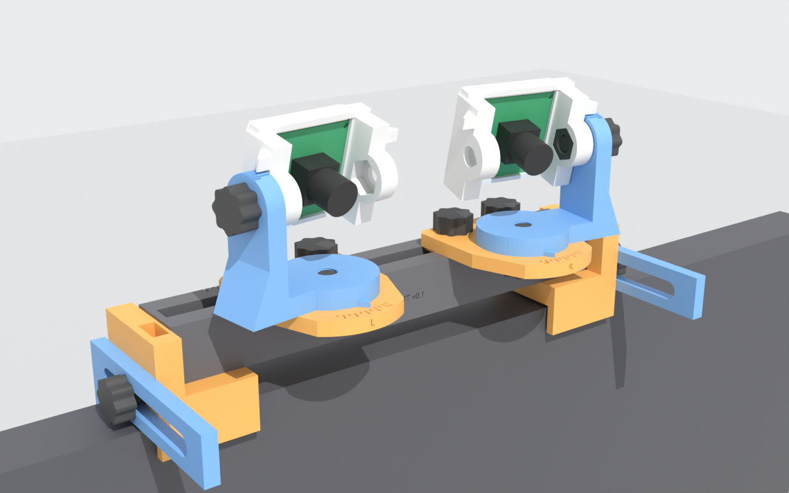

# Stereo camera mount v0.1

A test fixture that holds the two Arducam B0332 cameras **clamped on the top edge of
the monitor**, looking down at the user. Desk feet are an alternative. It provides:

- a readable, lockable baseline from 70 to 160 mm,
- independent yaw and pitch for each camera, ±25°.

**Everything is printed**, in PETG: no screws, nuts or other bought hardware. All joints
use one printed thread, and every adjustment locks with a knob-headed printed screw, so
no tools are needed.

The generator, [`hardware/mount-v0.1`](../../hardware/mount-v0.1/README.md), produces the
geometry, STLs, `.blend` file and renders. The camera dimensions it relies on, and which
of them are assumed, are in [camera-b0332.md](camera-b0332.md).

## Coordinates and settings

These conventions are shared with the diagnostics software and are named parameters in
the generator:

- **Rig origin** is the midpoint between the two optical centres. **+X** points to the
  user's right, **+Y** up and **+Z** toward the user. `cam_left` is at −X and `cam_right`
  at +X, as seen by the user facing the cameras.
- **Baseline** is the distance between the two optical axes at the pivot plane.
- **Angles:** `yaw_deg` and `pitch_deg` are 0 when the camera looks along +Z. Positive yaw
  turns toward the rig centre. Positive pitch turns up, so **on the monitor the cameras
  use negative pitch**.
- **Pivots:** the yaw and pitch axes both pass through the assumed optical centre, on the
  lens axis 12 mm in front of the PCB. Changing an angle therefore does not move the
  optical centre, and the baseline reading holds at any angle.
- **Height:** the optical axes are **82.5 mm above the monitor's top edge**, or 81 mm
  above the desk on the feet. The camera bodies sit 12 mm in front of the screen surface.

**Is the user in view from the monitor top?** Assume the eyes are 500–700 mm from the
screen, between 150 mm below and 50 mm above the screen's top edge. The eyes are then
2.7–24.9° below horizontal from the cameras. At a pitch of about **−14°**, the 47° vertical
field of view covers that whole range with 12° to spare, and −14° is well inside the
±25° pitch range. The build computes this (`ranges.user_view_on_monitor` in the
validation report).

## Parts

| Part | Qty | Function |
|---|---|---|
| `rail` | 1 | 216 mm bar with a slot along its top, a nut tunnel inside and a key groove underneath. The top carries the baseline scale, with numbers on the back face. The groove ceiling has a threaded hole at each end for the bracket screws |
| `monitor_clamp_left` / `_right` | 1 + 1 | Rest on the monitor's top edge under the rail ends. A 4 mm lip hooks over the front bezel, reaching 12 mm down. An ear beyond the rail end holds the rear arm's nut and also stops the rail sideways |
| `clamp_arm` | 2 | Rear jaw. Its slotted bar slides along the ear, and its leg presses on the back of the monitor. It grips monitor tops **12.5–74.5 mm deep**, measured where the leg touches, and an engraved scale reads the depth at the lip's front face. Either side fits |
| `desk_foot` | 2 | *Optional*: stands the rail on a desk instead, and swaps for the clamps with the same screw |
| `carriage_left` / `_right` | 1 + 1 | Slide on the rail, guided by a key in the slot and locked by two screws. Carry the yaw scale and a V notch that reads the baseline. Engraved L/R |
| `yoke_left` / `_right` | 1 + 1 | Turn on the carriage about the yaw axis, with a pointer for the yaw scale. The yaw screw threads into the base. A single arm on the outer side holds the pitch axis, so the cameras can stand close together. The arm rim carries the pitch scale |
| `camera_holder` | 2 | The PCB slides in from the top: it rests on a floor ledge, between four standoffs behind it and two ribs over its side edges in front. Rear window for the connector, an open front so the lens can be focused, and a fin that reads the pitch scale. The two holders are identical |
| `pcb_keeper` | 2 | Bar that pegs into the holder's wall tops and holds the PCB down |
| `screw_rail_lock` | 4 | Knob-headed screw, 17.5 mm thread: carriage to a nut in the rail tunnel. Two per carriage |
| `screw_yaw` | 2 | Knob under the carriage, 13.5 mm thread into the yoke base |
| `screw_pitch` | 2 | Knob outside the yoke arm, 16.3 mm thread into a nut inside the holder wall |
| `screw_clamp` | 2 | Knob outside the rear arm, 14.5 mm thread into a nut in the clamp's ear |
| `screw_bracket` | 2 | Flat knurled head with a coin slot, 16.2 mm thread: up through the saddle into the rail floor. It sits in a recess, so nothing presses on the monitor |
| `nut` | 8 | Printed hex nut: 4 in the rail tunnel, 2 in the holder walls, 2 in the clamp ears |
| `coupon_pcb`, `coupon_rail`, `coupon_slider`, `coupon_thread` | 1 each | Fit tests, printed first |

**The printed thread.** Every screw, nut and threaded hole uses one thread: 8 mm
diameter, 2 mm pitch, with 45° flanks instead of ISO's 60°. A 45° flank prints without
support on a screw standing head down and in a hole printed vertically, and the coarse
pitch survives a 0.4 mm nozzle. Threaded holes are the screw grown by 0.3 mm (a FIT
value), with a lead-in countersink. Screws and nuts are printed in the orientation that
puts their threads vertical, and so are the threaded holes in the yoke and the rail.
Every joint engages at least 5.5 mm of thread (2.75 turns). Steel M8 screws do not fit
this thread.

**Every bracket attaches the same way.** The rail sits on the bracket's saddle and a boss
on the saddle keys into the rail's groove. One `screw_bracket`, inserted from below, goes
up through the saddle into the threaded hole in the rail floor.

## Bill of materials

Nothing but filament. Optional extras, not needed for the rig to work:

| Item | Notes |
|---|---|
| PETG filament, ≈ 380 g with the coupons | Estimated from the part volumes at 100 % fill; your slicer gives the real figure |
| Self-adhesive felt, 1.5 mm *(optional)* | Under each clamp saddle, inside each lip, on each arm leg, so no printed plastic touches the monitor. The geometry leaves room for it; without it the lip simply sits 1.5 mm off the bezel |
| Cable tie, string or Velcro strap *(optional)* | Strain relief through the slot pairs on the holder and behind the rail |

## Printing on the Bambu Lab P2S (PETG, 0.4 mm nozzle)

The P2S build volume is **256 × 256 × 256 mm** ([manufacturer spec via retailer][p2s1],
[second listing][p2s2]). The build checks every part against that volume, keeping 5 mm
inside each edge. The largest part is the rail at 216 × 28 × 24 mm, and the next is a
desk foot at 30 × 135 mm.

[p2s1]: https://www.gigaparts.com/bambu-lab-p2s-3d-printer.html
[p2s2]: https://www.makerpoint.nl/en-gb/3d-printing/3d-printers/bambu-lab-all/bambu-lab-p2s-210000007716

**Ready-made plates.** Open the files in `hardware/mount-v0.1/plates/` in Bambu Studio,
in this order:

| Plate | Contents | Use |
|---|---|---|
| `1-coupons.3mf` | The four coupons, 1 `pcb_keeper`, 1 `screw_rail_lock`, 1 `screw_bracket`, 2 nuts | Check the fit first (next section) |
| `2-mount.3mf` | The whole monitor rig: rail, both clamps, 2 clamp arms, both carriages, both yokes, 2 camera holders, 2 keepers, 12 screws, 8 nuts | Everything else, in one print |

The generator nests parts by their real footprints, not their bounding boxes, so screws
and nuts fill the corners of the L-shaped clamp arms. Each part is a separate object,
already in its print orientation and at least 6 mm from its neighbours and 5 mm from the
bed edge, so don't rotate or re-arrange anything. In Bambu Studio, give the screws and
nuts the fastener settings below as per-object settings; everything else can use the
stronger part setting (4 walls, 30 % gyroid).
Desk feet are not on a plate. Print `stl/desk_foot.stl` twice if you want them.

No part needs supports. Each STL is exported lying in its print orientation, centred, on
z = 0. Start from Bambu Studio's **Generic PETG** (or your filament's) profile on the
textured PEI plate, and change only:

| Setting | Value |
|---|---|
| Layer height | 0.2 mm (0.16 mm prints smoother threads, if you print the fasteners separately) |
| Walls | **6 for screws and nuts**; 4 for yokes, holders, keepers, clamps and arms; 3 elsewhere |
| Infill | **100 % for screws and nuts**; 30 % gyroid for yokes, holders, clamps and arms; 20 % for the rail and carriages |
| Supports | Off |
| Elephant-foot compensation | 0.15 mm (the yaw scale is on the carriage face that prints on the plate) |

| STL | Orientation (already applied) |
|---|---|
| `rail` | Underside down; the tunnel and groove print as short bridges, and the bracket threads stand vertical |
| `monitor_clamp_*` | Front face of the lip on the plate. The key boss has a 45° back, and the horizontal holes are teardrops |
| `clamp_arm` | Flat, depth scale up |
| `desk_foot` | Pad down |
| `carriage_*` | Upside down: key up, scale face on the plate |
| `yoke_*` | Base down, so the yaw thread stands vertical; pitch hole is a teardrop |
| `camera_holder` | Rear plate down; fins have 45° undersides; the pitch hole and keeper holes are teardrops |
| `pcb_keeper` | Bar flat, pegs and tongue up |
| `screw_*` | Head down, thread up |
| `nut` | Flat |

## First print: the fit coupons (about 1.5 hours)

Print `1-coupons.3mf`, then check:

1. **PCB in `coupon_pcb`:**
   - The camera slides down from the top between the ribs and the standoffs, sits flat
     on the standoffs, and stops on the floor ledge without forcing.
   - Nothing on the front of the board within 1.2 mm of its left and right edges hits
     the ribs, and nothing on the back touches the plate: the standoffs are 5 mm and
     the window is 26 × 26 mm.
   - `pcb_keeper` pegs into the two wall tops and holds the board without rattling.
2. **Threads on `coupon_thread`:**
   - `screw_rail_lock` turns into the vertical threaded hole by hand, all the way.
   - A nut slides into the side pocket and cannot turn, and the screw goes through the
     teardrop hole and threads into it.
3. **`coupon_rail`:**
   - A nut slides through the tunnel without spinning.
   - `coupon_slider` drops into the slot and slides with light friction.
   - Screw the slider down with `screw_rail_lock` into the tunnel nut. It must clamp
     firmly by hand.
   - `screw_bracket` turns into the threaded hole in the groove ceiling, from below.

If a fit is off, change the matching FIT value in `params.py` and rebuild. A thread that
binds or wobbles: `thread_clearance`. A screw that does not pass a hole:
`shank_clearance`. A loose or tight nut pocket: `nut_pocket_af`. A tight PCB:
`pcb_side_clearance` or `pcb_slot_clearance`.

## Assembly

Screw everything by hand. If a thread is stiff, run the screw in and out a few times
before you assemble.

1. **Rail nuts:** slide two nuts into each end of the rail tunnel.
2. **Clamps:**
   - Optional: stick felt under each clamp saddle and inside each lip.
   - Drop a nut into the slot in each ear.
   - Set the rail on the two saddles, with the boss in the groove and the rail ends
     against the ears.
   - Screw each clamp on from below with a `screw_bracket`, head in the saddle recess,
     up into the rail floor. Tighten it with a coin.
3. **Carriages:**
   - Set each carriage on the rail with its key in the slot, L on the user's left.
   - Turn two `screw_rail_lock` through the carriage into the tunnel nuts, and snug them.
4. **Yokes:**
   - Set the yoke on the carriage with its arm on the outer side.
   - From under the carriage, turn a `screw_yaw` up into the yoke base.
5. **Cameras:**
   - Push a nut into the inner pocket of the holder wall that will face the yoke arm.
   - Slide the PCB down into the holder, lens to the front, until it stops on the floor
     ledge.
   - Peg `pcb_keeper` onto the wall tops.
6. **Holders:** hold each one in its yoke, and turn a `screw_pitch` through the arm into
   the wall nut.
7. **On the monitor:**
   - Optional: stick felt on each arm leg's inner face.
   - Hang the rig on the top edge with the lips over the front bezel, centred on the
     screen.
   - Put each arm on its ear with the leg behind the monitor, and turn a `screw_clamp`
     through the slot into the ear nut.
   - Slide each arm forward until the leg touches, then tighten. The depth scale on the
     bar, read at the lip's front face, gives the setting for next time.
8. **Cables:**
   - Plug in USB, leaving a loose loop for yaw and pitch.
   - Optionally tie the cable through the slot pair on the holder's rear plate and the
     slot pair on the clamp saddle behind the rail.
   - Let it hang down the back of the monitor.

## Setting and reading the adjustments

| Adjustment | Unlock | Read |
|---|---|---|
| Baseline | the two knobs on the carriage | The V notch in the carriage's back edge against the rail scale, read from behind. With both carriages on the same mark, that mark *is* the baseline. Ticks every 5 mm, numbers every 20 mm, long tick at 100 |
| Yaw | the knob under the carriage | The yoke pointer against the carriage ticks: every 5°, long every 10°. The dimple marks **positive**, toward the rig centre |
| Pitch | the knob on the yoke arm | The front face of the holder's fin against the ticks on the arm rim. The dimple marks **positive**, up; on the monitor you will use the other side |
| Monitor depth | the knob on each rear arm | The tick on the arm's bar at the lip's front face: every 10 mm, long every 20 mm |

Hold the camera while tightening yaw or pitch. Record settings as
`baseline, cam_left yaw/pitch, cam_right yaw/pitch`.

## What has been verified, and how

**CAD-level checks.** These ran in the cloud with Blender 5.2.3 through `build.py`, and
the results are in [`validation/report.json`](../../hardware/mount-v0.1/validation/report.json):

- **Meshes:** all 21 printable meshes are closed, manifold, single bodies with positive
  volume, and fit the P2S volume with a 5 mm margin.
- **Overhangs:** the thread flanks are 45°, the limit. The only faces steeper than that
  are inside engraved numbers and letters (≈ 28 mm² on the rail, 0.6 mm² on the "R").
  Everything else is a bridge over a hole, groove or channel; the shortest are the
  holder's front ribs, 1.2 mm over the PCB slot.
- **Camera fit:** the reference camera, with its assumed dimensions, does not overlap the
  holder.
  - PCB: 0.3 mm side play, 0.25 mm play between the standoffs and the ribs.
  - Lens: ≥ 8.5 mm from the holder.
  - Rear parts: ≥ 0.5 mm from the holder.
- **Motion:** 585 poses found no collisions between any parts, screws, nuts, cameras, or
  the monitor stand-in. Screws are checked on a plain shank at the thread's minor
  diameter: two printed threads would clash wherever their helices are not phased as
  printed, which says nothing about fit. The sweep covers:
  - the desk stand, and the monitor clamp at both its thinnest (12.5 mm) and thickest
    (74.5 mm) setting,
  - baselines 70, 100 and 160 mm,
  - yaw −25…+25° in 5° steps,
  - pitch −25…+25° in 12.5° steps,
  - both cameras turned the same way and opposite ways.

  A self-test confirms that the checker catches a deliberate overlap.
- **Connector access:** the USB plug-and-cable keep-out hits no other part in any pose.
- **Field of view:** the monitor never enters the image. Only the clamp's rear arm does,
  at −25° pitch with −25° yaw (looking down and outward), a setting that is not used
  when looking at the user.
- **User in view:** see *Coordinates and settings* above.
- **Threads:** every screw engages 5.5–7.5 mm of thread and has room past its tip.

**Not verified (needs hardware):**

- Every camera dimension marked ASSUMED, in particular the hole pattern, rear component
  height, connector position and optical centre.
- Printed tolerances: thread clearance, nut pockets, PCB slot, key slide, teardrop holes.
- Printed threads: how much torque a hand-tight PETG thread holds before it slips or a
  screw snaps at a layer line. Screws printed standing are weakest in tension.
- Lock holding torque, scale repeatability and accuracy.
- Stiffness on the monitor:
  - whether typing or touching the monitor shakes the image,
  - whether the clamp shifts on a glossy or curved top edge,
  - whether the lip covers any pixels on your monitor's bezel.
- Fit on your monitor: the top-edge depth at the leg's height, and whether the back is
  flat enough there for the leg.

## Physical tests to run

1. **The coupons above.** Report the PCB fit, the thread fit, the nut pockets and the
   rail clamp.
2. **Camera measurements** listed in [camera-b0332.md](camera-b0332.md).
3. **Your monitor:**
   - top-edge thickness at 0, 20 and 40 mm below the top, front to back;
   - bezel height above the first pixel row;
   - whether the top edge is flat.
4. **Clamp:** hang the rig, tighten the arms, then tap the rig sideways and forward. It
   must not shift or tip.
5. **Baseline scale:** set 70, 100 and 160 mm. Measure between the lens barrel centres
   with calipers; the error should be under 1 mm.
6. **Angles:** check pitch at 0 and −20° with a phone inclinometer on the holder back,
   and yaw against a printed protractor.
7. **Repeatability and stability:**
   - Set, disturb and reset an angle five times, recording an image each time.
   - Watch the live preview while typing and while touching the monitor.

## Known limitations of v0.1

- **PCB edges:** the holder grips the board by its left and right edges, assuming
  nothing on the front sits within 1.2 mm of them. The standoffs assume the 34 mm hole
  square; a board with only the 28 mm set needs one parameter changed.
- **Printed threads:** a screw stripped or snapped while tightening is a reprint. Spares
  print in minutes from `stl/`.
- **Baseline scale:** it is read from behind the rig.
- **Height:** it is fixed at about 80 mm above the monitor top. There is no riser.
- **Pitch arm:** it is single-sided, chosen to reach the 70 mm minimum baseline. It is
  stiff enough on paper but untested.
- **Clamp grip:** the clamp holds by the lip and the rear arm. Very thin or
  strongly curved monitor tops (< 12.5 mm deep where the leg touches) are out of range.
